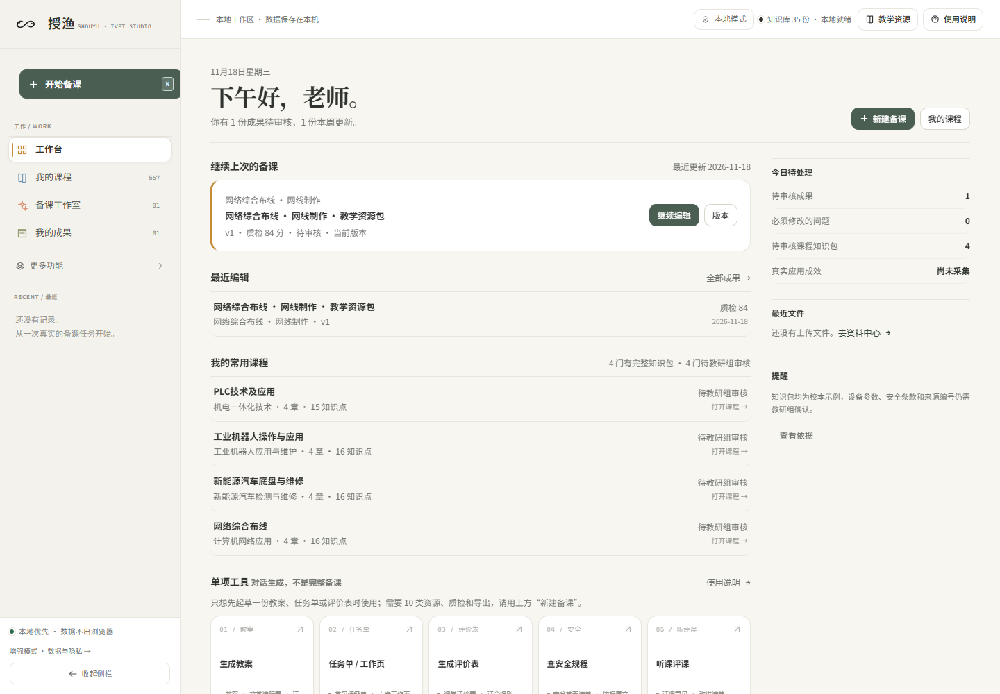
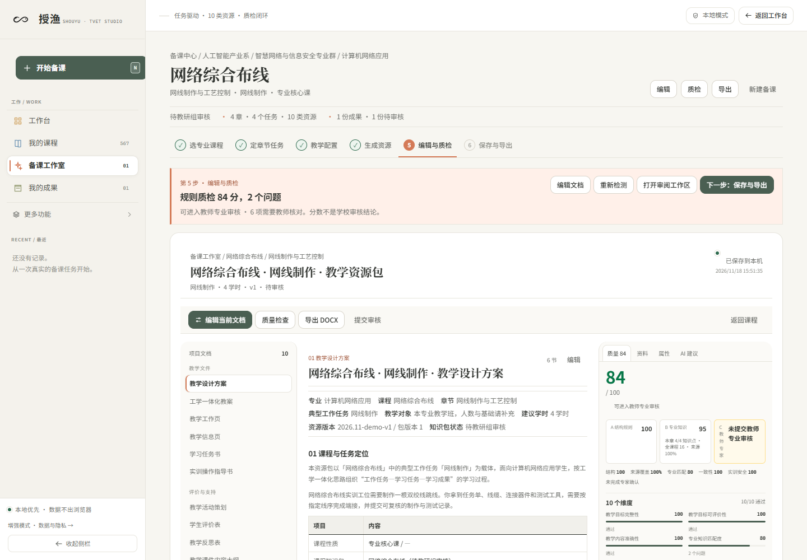

# 授渔 V3.0 · 以课程为中心的工学一体化教师工作平台

> 竞赛冲刺二次优化 · 2026-11-17：三专业标杆知识包、三层质量检测、真实应用成效记录、离线演示加固。

> 工作型 UI 重构 · 2026-11-17：中性工作底色、统一品牌操作色、八模块只做识别；首页、备课、质检、知识库改为真实工作界面。只改前端结构与样式，不改业务逻辑。

> 操作体验专项整改 · 2026-11-17：统一“开始备课”入口、六步备课、草稿恢复、成果版本、教学资源带入备课；新建不再预选 PLC。

> V3 信息架构 · 2026-11-17：四个一级区域（工作台、我的课程、备课工作室、我的成果）、课程工作空间、统一备课项目、项目内嵌质量检测、持久化课程/项目上下文。

> UI 圆润化 · 2026-11-18：统一 8/10/14/16/20/999 圆角层级、150–270ms 动效系统、柔和阴影与 reduced-motion；不改变导航、业务逻辑、数据结构或导出流程。详见 [圆润化与动效优化报告](docs/圆润化与动效优化报告.md)。


> 专业数据库 → 课程知识包 → 10 类教学资源 → 可解释质检 → 教师审核 → 标准导出。

> 本地引擎保底，增强模式可选；有依据、可编辑、可导出、可审核。

**固定访问地址：** [https://htfyu.github.io/shouyu-teacher/](https://htfyu.github.io/shouyu-teacher/)  
**代码仓库：** [https://github.com/htfyu/shouyu-teacher](https://github.com/htfyu/shouyu-teacher)  
**旧地址：** `https://htfyu.github.io/jiangbei-teacher/` 已保留自动跳转，旧链接不会直接失效。





> V3 架构：[产品信息架构](docs/V3产品信息架构.md) · [教师工作流程](docs/V3教师工作流程.md) · [数据模型与迁移](docs/V3数据模型与迁移.md) · [V3 功能回归](docs/V3功能回归报告.md)

> 操作体验：[教师操作流程](docs/操作流程说明.md) · [体验整改报告](docs/操作体验整改报告.md) · [问题修复清单](docs/问题修复清单.md) · [自动化测试报告](docs/测试报告.md)

> 工作型 UI：[原版与新版视觉对照](docs/visual/原版与新版视觉对照.png) · [色彩 Token 表](docs/视觉设计/色彩Token表.md) · [UI 设计规范](docs/UI设计规范.md) · [公共组件规范](docs/公共组件规范.md) · [UI 审计报告](docs/工作型UI审计报告.md)

---

## 一、V2 做了什么

### 1. 双引擎

| 模式 | 能力 | 数据边界 |
|---|---|---|
| 本地模式 | 规则 + 知识库 + 结构化模板，生成教案 / 任务单 / 工作页 / 评价表 / 安全清单 / 评课意见 | 不联网；数据留在浏览器 |
| AI 增强模式 | 真实大模型，流式输出；基于知识库与任务条件改写关键模块，再合并回本地完整结构 | 调用前必须明确同意；发送前执行隐私检查；失败自动回退本地 |

- **AI 体验通道**：无密钥的公开推理服务（`text.pollinations.ai`，匿名 `openai-fast`），用于在线作品演示。它不含任何 API Key，但会把必要上下文发送给第三方公开服务；不适合敏感资料。
- **生产安全代理**：`server/` 提供 Cloudflare Worker 与 Vercel Function。模型 Key 只存在服务端环境变量，浏览器没有 Key 字段。
- AI 只改写“学习目标 / 教学流程 / 评价 / 安全”等关键模块，避免匿名模型输出长度上限导致整篇教案被截成半成品；未覆盖的模块保留本地完整内容。
- 安全类查询、超范围问题、隐私请求和参数澄清固定由本地边界层处理，不交给生成模型。

### 2. 十三个专业方向知识材料

知识库现有 **35 份材料 / 155 个可检索章节**：

- 原有 9 份校本示例（课程设计、教案、任务单、工作页、安全、评价、听评课、数据合规）；
- 新增 13 个专业包，每个专业 2 份材料、4 个章节：电气自动化、PLC 技术、数控技术、汽车维修、工业机器人、机械加工、焊接技术、电子技术、计算机技术、建筑工程、化工技术、新能源技术、网络综合布线。

检索为**本地混合检索**：标题 / 标签 / 正文 n-gram + 场景权重 + 领域概念扩展（同义词、上下位词），不是神经网络向量检索。引用细化到 `KB-xx §nn`。

知识库支持：新增、编辑、删除自定义材料；JSON 批量导入 / 导出；重复检测；版本记录；分块；来源 / 作者 / 发布时间 / 版本 / 适用范围展示。内置材料只读，可“复制为自定义”后修改。

### 3. 资料中心

支持 **TXT / MD / CSV / JSON / DOCX / PDF / XLSX / PPTX**：

- 全部在本机解析，不上传原文件；
- 多文件、可配置大小上限、上传与解析进度；
- 保留全文并按语义边界分块，不简单截断；
- DOCX 段落 / 表格；PDF 逐页文本；XLSX 多工作表；PPTX 多页；
- 扫描版 PDF 标记 `needsOCR`，可选 Tesseract OCR（唯一会访问外部 CDN 的解析步骤，需同意）；
- 解析后预览、隐私检查、自动脱敏、决定是否加入知识库；
- 解析失败给出具体错误码与中文原因。

### 4. 编辑器与导出

- 成果编辑器：分栏实时预览、标题 / 正文 / 表格编辑、模块拖动排序、撤销 / 恢复、自动保存；
- 真实 **DOCX**：标题、段落、表格、页码、来源附录；
- **XLSX**：正文 / 表格 / 引用来源分表；
- **TXT / Markdown**；
- **PDF**：通过浏览器打印面板另存（保留中文字体与分页，不伪装成服务端 PDF 生成）。

### 5. 历史与数据管理

- 对话、自定义知识、资料、设置优先存入 **IndexedDB**，localStorage 只作轻量兼容与迁移；
- 自动标题、搜索、分类、收藏、改名、单条删除、批量删除；
- 完整 JSON 备份 / 恢复；数据占用显示；删除本机个人数据；
- 明确声明：**本机存储不是跨设备同步**。

### 6. 隐私保护

- 规则检测身份证（含校验位）、手机、邮箱、学号、学生 / 家长姓名上下文、地址、QQ / 微信、银行卡等；
- AI 发送前隐私网关：掩码展示、人工确认、自动脱敏后发送或取消；
- 资料上传前同样检查，默认只保存脱敏后的文本；
- 不在日志中记录完整敏感内容；
- AI 输出、安全条款、评价权重均标注“待人工审核”。

### 7. 专业体系与课程资源库

- 导入《广州市技师学院专业体系数据库.xlsx》全部明细：**6 个教学单位、13 个专业组 / 学科组、56 个专业条目、75 条招生计划、567 条课程记录、134 条来源**；
- 保留 `专业系 → 专业组 → 专业 → 课程` 四级关联，保留原表的“暂无公开资料”“推定”“未纳入现行专业群”等状态，不静默合并或改写；
- 课程资源包含 10 个模块：课程简介、教学目标、教学内容与知识体系、重点难点、教学计划、教学方法、实训项目、考核评价、教学资源、来源与校核；
- 原表有官方简介的课程优先展示原文（13 条）；缺失资料明确标注“待完善”，其余提供明确标注的“行业通用参考”备课脚手架，不冒充学院官方文件；
- 支持关键词搜索、专业系 / 专业组 / 专业逐级筛选、课程类别筛选、来源链接与发布日期展示；
- 支持专业系 / 组 / 专业 / 课程的新增、编辑、隐藏和恢复；有子记录时禁止删除，避免破坏层级；
- 课程资料可由教师编辑，保存在独立的 IndexedDB 修订库；支持导出 / 导入修订，并纳入完整 JSON 备份；
- 可将课程一键带入既有教案生成流程（专业、课程预填）；
- 原始数据表随站点提供下载；数据导入与边界说明见 [docs/专业数据库导入说明.md](docs/专业数据库导入说明.md)。

### 8. 专业知识驱动的资源开发与质量检测

V3 工作区：

| 路由 | 能力 |
|---|---|
| `#/` 工作台 | 继续上次项目、最近成果、常用课程、待处理 |
| `#/courses` 我的课程 | 567 条课程目录、搜索、教学单位筛选、完整知识包 |
| `#/course/:id` 课程工作空间 | 概览、章节任务、专业知识、课程资料、备课项目、教学成果 |
| `#/studio` 备课工作室 | 六步备课；项目文档目录 + 当前文档 + 质量/资料/属性/AI；质量检测内嵌；导出 |
| `#/quality` 质量检测历史 | 10 维规则评分、权重配置、问题定位、证据/建议、人工复核、报告下载 |
| `#/graph` 知识图谱 | 课程→章节→知识点→任务；只画有数据的边；节点显示来源/审核状态 |
| `#/portfolio` 我的成果 | 按项目查看课程、章节、任务、版本、质检、审核、导出 |
| `#/impact` 教学应用成效 | 真实教师测量记录、传统/智能备课对比图、导入导出、匿名化 |
| `#/demo` 竞赛演示 | 固定 PLC 案例，本地可重复运行；状态、进度、失败恢复 |
| `#/programs` 专业数据库 | 完整 6/13/56/75/567/134 条原始记录与课程资料 |

核心实现：

- **4 门不同专业方向的标杆课程知识包**：
  - `CUR-PLC-001` PLC技术及应用（机电一体化技术）：4 章 / 15 知识点 / 5 任务；
  - `CUR-ROBOT-001` 工业机器人操作与应用（工业机器人应用与维护）：4 章 / 16 知识点 / 5 任务；
  - `CUR-NEV-001` 新能源汽车底盘与维修（新能源汽车检测与维修）：4 章 / 16 知识点 / 5 任务；
  - `CUR-CABLING-001` 网络综合布线（计算机网络应用）：4 章 / 16 知识点 / 4 任务；
- 每门包包含章节、知识点、典型工作任务、教学目标、实训要求、设备、安全、考核，并带审核人/审核状态/版本/更新时间；
- 知识点/任务带 `PK` 校本示例来源；课程身份采用来源表比对后的 `S` 官方专业来源；
- **严格区分 567 条课程目录记录、13 条官方课程简介、4 门完整知识包、0 门已审核知识包**；其余课程明确标为“行业通用参考”；
- 10 类资源：教学设计方案、教案、工作页、信息页、学习任务书、实训操作指导书、活动策划、评价表、反思表、课件大纲；
- **质量检测三层**：A 结构规则、B 专业知识（知识点覆盖/来源/设备/参数）、C 教师专家审核；三层分数与状态分开显示；
- 质检 10 维，但**来源覆盖率不等于事实正确率**；参数、设备、操作逻辑和无法自动判断的内容列为教师审核项；
- 未提交教师专业审核或知识包待审核时，综合分最高 84，且**不会显示“已通过专家认证”**；行业参考最高 72；
- 教师审核必须逐项勾选“待核对知识依据”，才能标记“已通过”；记录审核人、意见、修改记录和时间；
- 质量问题含等级、位置、依据、建议；只自动修复权重归一化、缺失安全章节等结构问题；
- **教学应用成效**：只记录真实测量（教师/课程/时间/人工修改比例/评价/专家结果），无数据时显示“尚未采集”，支持导入/导出/CSV/匿名导出；
- 成果库保存最近 4 个内容版本，可恢复；完整备份包含成果库和应用成效；
- DOCX 增加封面、文档目录、表格防跨页、教师/教研组签字区；PDF 打印增加目录。

> 四门知识包均为**校本示例 · 待教研组审核**，不是学院正式课程标准。原表课程来源编号存在错配（PLC 的 S20/S27、工业机器人的 S24/S27、新能源的 S14/S37、网络综合布线的 S1/S7/S36），系统保留原值并警示，知识包采用来源表比对后的来源；详见 [docs/数据来源与审核依据清单.md](docs/数据来源与审核依据清单.md)。

### 9. 工作型 UI

- **中性工作底色**：页面 `#F7F6F1`、内容 `#FFFFFF`、正文 `#30332F`；页面不再随模块变成八种底色；
- **统一品牌操作色** `#4A5F52`：所有页面的主按钮、核心操作、当前选中使用同一套交互色；
- **八模块只做识别**：工作台金、专业蓝、知识绿、备课橘、质检紫、图谱青、资料雾霾蓝、成果橄榄绿，只用于导航图标、当前项细条、分类标签和少量状态；
- **核心导航四项**：工作台、我的课程、备课工作室、我的成果；专业数据库、知识库、图谱、质量检测历史、资料、模板等进入“更多功能”；
- **首页是工作台**：日期问候、继续上次备课、最近编辑、常用课程、今日待处理、最近文件；不再有宣传 Hero 和四张系统统计大卡；
- **备课是六步流程**：选专业课程 → 定章节任务 → 教学配置 → 生成资源 → 编辑质检 → 保存导出；生成后默认双栏，知识资料收进可折叠辅助栏；
- **入口语义统一**：所有“开始备课/新建备课”进入六步流程，新建不预选 PLC；“新建对话”只用于 AI 对话；
- **质检是审阅工作区**：左问题清单 + 中原文定位 + 右规则/建议/人工审核；支持忽略提醒、恢复、结构修复和编辑器修改；
- **教学资源是检索阅读空间**：分类 + 资料列表 + 正文阅读 + 用于备课；手机端分类改为下拉；
- **排版规范**：正文 14px，辅助文字不低于 12px；圆角 4/6/8/10px，减少阴影和装饰；
- 1920 / 1440 / 1024 / 768 / 390 宽度回归；无横向溢出；控制台 0 新增错误；
- 规范见 [UI 设计规范](docs/UI设计规范.md)、[色彩 Token 表](docs/视觉设计/色彩Token表.md)、[UI 审计报告](docs/工作型UI审计报告.md)、[响应式检查报告](docs/响应式检查报告.md)。

---

## 二、快速开始

无需构建、无需安装前端依赖：

```bash
# 项目根目录
python -m http.server 5598 --bind 127.0.0.1
# 打开 http://127.0.0.1:5598/
```

> 不要直接双击 `index.html`；ES Module 在 `file://` 下无法加载。  
> GitHub Pages 直接部署静态文件即可，`.nojekyll` 已保留。

### 可选：开启线上 AI 体验通道

1. 打开「AI 与数据设置」；
2. 切换 AI 增强，阅读并同意第三方数据传输说明；
3. 直接生成或对话。体验通道无需填写任何模型 Key。

体验通道的限制：匿名、限速、输出长度上限、可能排队或不可用；不适合敏感资料。生产环境请使用下面的安全代理。

### 推荐：部署安全 AI 代理

详见 [server/README.md](server/README.md)。

```bash
# Cloudflare Worker（推荐）
cd server
wrangler secret put AI_API_KEY
wrangler secret put ACCESS_TOKEN   # 可选
wrangler deploy
```

关键环境变量：

| 变量 | 说明 |
|---|---|
| `AI_API_KEY` | 服务端 secret；模型 Key，绝不进前端 |
| `AI_BASE_URL` | OpenAI-compatible 基址，默认 `https://api.deepseek.com` |
| `AI_MODEL` | 服务端固定模型，默认 `deepseek-chat` |
| `ALLOWED_ORIGINS` | 允许的前端 Origin，逗号分隔，不支持 `*` |
| `ACCESS_TOKEN` | 可选，代理访问口令（不是模型 Key） |
| `AI_TIMEOUT_MS` | 上游超时，默认 60000ms |

部署后在「AI 与数据设置」选择「学校 / 自建安全代理」，填写：

- 代理接口：`https://<worker>.workers.dev/api/chat`
- 模型名称：显示用，实际由服务端 `AI_MODEL` 决定
- 服务访问口令：可选，仅当前标签页会话保存

前端没有模型 API Key 输入项；模型 Key 泄露风险由服务端环境变量隔离。

---

## 三、项目结构

```text
.
├─ index.html
├─ assets/
│  ├─ brand/                     # 授渔 logo、透明黑线标与 favicon
│  ├─ styles.css                 # 原有基础样式与业务组件
│  ├─ ui-refresh.css             # 原布局与组件层
│  ├─ work-theme.css             # 工作型主题：中性色、统一品牌操作色、页面布局
│  ├─ rounded-motion.css         # 圆角、柔和阴影、hover/focus、页面与弹窗动效、reduced-motion
│  └─ vendor/                    # 按需加载的本地解析/导出依赖（约 4MB）
│     ├─ mammoth/                # DOCX
│     ├─ pdfjs/                  # PDF + worker + cmaps
│     ├─ xlsx/                   # SheetJS
│     └─ jszip/                  # PPTX / DOCX 打包
├─ js/
│  ├─ app.js                     # 路由、页面、表单、对话、编辑器、文件中心、历史
│  ├─ engine.js                  # 检索、结构化生成、边界、安全、参数更新
│  ├─ knowledge.js               # 基础知识库 + 12 专业包注册 + 自定义材料 API
│  ├─ knowledge-packs.js         # 12 专业 × 2 份材料 × 4 章节
│  ├─ ai.js                      # 双通道 AI 适配、SSE 流式、连接检查
│  ├─ ai-prompts.js              # 边界提示词、知识库上下文、生成格式
│  ├─ ai-artifacts.js            # AI Markdown → 本地成果结构，引用校验与合并
│  ├─ files.js                   # 多格式解析、分块、进度、OCR 接口
│  ├─ privacy.js                 # 本地隐私检测与脱敏
│  ├─ db.js                      # IndexedDB、备份、恢复、占用
│  ├─ programs-data.js           # Excel 生成的 6/13/56/75/567/134 条基础目录
│  ├─ programs-store.js          # 四级目录合并、IndexedDB 修订、CRUD、备份
│  ├─ programs-content.js        # 课程资源脚手架、官方/参考/待完善分层
│  ├─ curriculum-data.js         # 4 门标杆课程知识包（各 4 章/15—16 知识点/4—5 任务/来源）
│  ├─ curriculum.js              # 课程知识装配、行业参考降级、来源解析
│  ├─ teaching-engine.js         # 10 类工学一体化资源装配
│  ├─ quality-engine.js          # 三层/10 维规则质检、一致性、自动结构修复
│  ├─ studio-store.js            # 成果/版本/质检/审核持久化
│  ├─ impact-engine.js           # 真实应用成效校验、聚合、匿名化、CSV
│  ├─ impact-store.js            # 应用成效 IndexedDB / 兼容回退
│  └─ export.js                  # DOCX / XLSX / TXT / Markdown / 打印 PDF
├─ data/
│  ├─ gzgj-professional-system.xlsx  # 上传的原始数据表（只读种子）
│  └─ programs-summary.json      # 导入统计与抽样核验
├─ tools/
│  └─ generate_programs_data.py  # 从 Excel 生成 programs-data.js
├─ server/
│  ├─ cloudflare-worker.js       # 安全代理（主）
│  ├─ vercel/                    # Vercel Serverless 备选
│  ├─ wrangler.toml
│  └─ README.md                  # 部署、安全、限制
├─ tests/                        # 单元 / 浏览器测试
├─ docs/
│  ├─ 升级架构与实施计划.md
│  ├─ AI接入与部署.md
│  ├─ 知识库管理说明.md
│  ├─ 文件解析说明.md
│  ├─ 数据备份与恢复.md
│  ├─ 部署说明.md
│  ├─ 模块扩展说明.md
│  ├─ UI设计规范.md
│  ├─ 专业数据库导入说明.md
│  ├─ 测试报告.md
│  ├─ 已修复问题清单.md
│  ├─ 尚未实现功能清单.md
│  ├─ 使用说明.md
│  ├─ 演示脚本.md
│  ├─ 作品设计方案.md
│  ├─ 竞赛级升级审计报告.md
│  ├─ 竞赛级升级功能改造清单.md
│  ├─ 原系统与升级系统对比报告.md
│  ├─ 核心技术架构.md
│  ├─ 专业数据库与知识库结构.md
│  ├─ AI教学引擎工作流程.md
│  ├─ 教学质量检测规则.md
│  ├─ 数据来源与审核依据清单.md
│  ├─ 竞赛演示操作指南.md
│  ├─ 竞赛答辩要点.md
│  ├─ 竞赛级升级交付说明.md
│  ├─ 视觉设计/                 # 色彩 Token 表
│  ├─ visual/                   # 原版/新版对照、八模块对照
│  ├─ 工作型UI审计报告.md
│  ├─ 公共组件规范.md
│  ├─ V3产品信息架构.md
│  ├─ V3教师工作流程.md
│  ├─ V3数据模型与迁移.md
│  ├─ V3功能回归报告.md
│  ├─ 操作流程说明.md
│  ├─ 操作体验整改报告.md
│  ├─ 问题修复清单.md
│  ├─ 工作型UI功能回归报告.md
│  ├─ 工作型UI未解决问题.md
│  ├─ CSS清理记录.md
│  ├─ 响应式检查报告.md
│  ├─ 视觉改造回归报告.md
│  ├─ 专业知识库改造报告.md
│  ├─ 专业数据来源核验报告.md
│  ├─ 教学应用成效模块说明.md
│  ├─ 示范成果/                 # 代表性 DOCX/MD/JSON
│  └─ screenshots/              # 实际运行界面截图
└─ .nojekyll
```

---

## 四、测试

```bash
# 单元测试：隐私 / 知识包 / 检索与五场景 / AI 成果合并 / 专业库 / 课程知识包与质检
npm run test:unit

# 文件解析 + 浏览器 E2E（首次需安装 Playwright）
npm --prefix tests install
$env:PLAYWRIGHT_CHANNEL='msedge'
npm --prefix tests run test:files
node tests/e2e.smoke.mjs
```

实际结果见 [docs/测试报告.md](docs/测试报告.md)。包含：

- 94 个单元测试（隐私 33、知识包 8、引擎 7、AI 合并 7、安全代理 Mock 8、专业数据库 9、课程知识包/资源引擎/三层质检/来源完整性/演示标记 17、应用成效 5）；
- 18 个文件解析用例（TXT / MD / CSV / JSON / DOCX / PDF / XLSX / PPTX / 分块 / BOM / 进度 / 无上传）；
- 73 项浏览器 E2E（路由、五场景、品牌标识 / favicon、首页工作台、四个核心导航、我的课程与课程工作空间、六步备课、统一项目工作区、侧栏折叠、资料分栏、模板标识、专业数据库四级浏览 / 检索 / 课程资源、10 类资源、4 门知识包、质检三层/10 维、质量中心、成果中心、知识图谱、演示一键生成与状态、应用成效未采集/录入/图表、完整备份清空后恢复、编辑器、DOCX / XLSX、文件解析、历史、移动端、控制台）；
- AI 体验通道真实流式生成、对话、截断提示与失败回退；新增单次自动重试（仅未收到文本时）；
- DOCX / XLSX 用 `python-docx` / `openpyxl` 独立打开验证；资源包 DOCX 含封面/目录/签字区（394 段、24 表）。

---

## 五、已知限制与未实现项

**已实现但有边界：**

- AI 体验通道为公开第三方服务，限速、输出上限、可用性不受本项目控制；生产必须换安全代理。
- AI 生成是“本地完整结构 + 关键模块改写”，不是整篇一次性生成；输出可能被截断，界面会提示。
- 安全查询仅提供电工 / PLC 的**操作级**专项规程；其他 11 个专业包含教学安全提示，但不能替代现场规程。
- PDF 导出依赖浏览器打印面板另存，不是服务端排版引擎。
- OCR 首次使用需联网加载 Tesseract；中文 OCR 准确率取决于扫描质量，默认只处理前几个低文本页。
- 隐私检测是规则 + 上下文 + 校验位，不是 NLP，不能保证查全或零误报。
- IndexedDB 未做加密；同一台电脑的其他用户可能通过浏览器配置访问。敏感资料请按学校规定处理。
- 依赖库均为本地 vendor；PDF / Office 复杂版式（页眉页脚、图表、公式）可能丢失，需人工校对。
- Cloudflare / Vercel 安全代理未在本环境实际部署（没有账号与模型 Key）；代码已提供并经 Mock 测试，部署步骤见 `server/README.md`。
- 课程知识包完成 4 门代表性课程；其余课程记录使用“行业通用参考”骨架，不是逐门审核过的知识包。
- 知识包在线教研组审核/签字、Word 自动页码目录域、逐段版本 diff 未实现。
- 原表课程来源编号存在错配（PLC 的 S20/S27、工业机器人的 S24/S27、新能源的 S14/S37）；界面保留原值并警示，正式使用前需教研组核对。
- 教学应用成效没有内置示例数据；未录入时所有图表显示“尚未采集”，不会用模拟数据冒充真实试用。

**未实现，不伪装：**

- 账号系统、云端同步、多用户权限；
- 学校级知识库与教学数据分析；
- 作为独立表单交付的智能命题、PPT 生成、教学管理（课程 / 班级 / 进度）模块；
- 服务端 PDF 排版、服务端 OCR、服务端文件存储；
- 生产级分布式限流、登录、计费、审计；
- 课程知识包在线审核签字、知识包编辑 UI、逐段版本 diff。

这些属于 P3 / 后续阶段；当前页面没有用空按钮冒充已完成。完整计划见 [docs/升级架构与实施计划.md](docs/升级架构与实施计划.md)。

---

## 六、安全说明

- 前端不包含任何模型 API Key；不要在本项目任何文件中写入 `sk-...`。
- AI 代理只接受白名单 Origin，限制请求体大小、超时与输出长度，不回传上游错误正文，不记录消息内容。
- 所有文档内容在插入页面前转义；AI 输出经结构化解析，不直接注入 HTML。
- 文件解析在本机完成，原始文件不上传；加入 AI 上下文前再次执行隐私检查。
- 备份 JSON 可能包含教学内容，请存放在学校批准的位置，不要发到未授权平台。

---

**授渔 SHOUYU / 2026** · 本地优先 · 双引擎 · 人工审核是最后一道工序