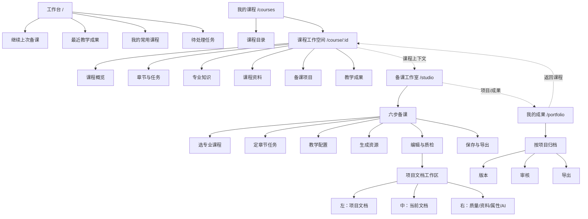

# 授渔 V3.0 · 产品信息架构

> 版本：2026-11-17  
> 定位：以课程为中心、以备课为主线、以教学成果为最终产出的教师工作平台。  
> 原则：教师不需要理解授渔的模块结构，只需要知道自己要教哪门课、这次教什么、最后留下什么成果。

## 一、产品定位

旧结构是“多个教学工具并列”：专业库、知识库、图谱、备课、质检、成果各自是一级入口。

V3 改为：

```text
我的课程（课程上下文）
   ↓
教学章节 / 典型工作任务
   ↓
备课项目（一次完整备课）
   ↓
10 类教学文档 + 质检 + 版本 + 导出
   ↓
我的成果（按项目和课程归档）
```

知识库、知识图谱、资料中心、模板库仍然保留，但属于课程/项目的资料视图和低频工具，不再与备课并列争夺主入口。

## 二、一级导航

### 四个核心区域

| 区域 | 路由 | 作用 |
|---|---|---|
| 工作台 | `/` | 继续上次项目、最近工作、常用课程、待处理、最近成果 |
| 我的课程 | `/courses` | 课程列表、课程工作空间、章节任务、知识资料、项目 |
| 备课工作室 | `/studio` | 六步备课、项目文档编辑、质量检查、导出 |
| 我的成果 | `/portfolio` | 项目、文档、版本、审核、导出记录 |

### 更多功能

`专业数据库 /programs`、`质量检测历史 /quality`、`专业知识库 /kb`、`知识图谱 /graph`、`资料中心 /files`、`模板库 /templates`、`教学应用成效 /impact`、`历史记录 /history`、`系统设置 /settings`、`使用说明 /guide`、`新建对话`。

路由全部保留，旧链接不会失效。

## 三、信息架构图



## 四、功能归属表

| 功能 | 主要归属 | 次要入口 | 不再是 |
|---|---|---|---|
| 专业系 / 专业组 / 专业 / 课程 | 我的课程 | 专业数据库（更多） | 一级“专业体系”入口 |
| 课程标准 / 知识包 | 课程工作空间 | 备课项目属性 | 独立页面 |
| 章节 / 典型工作任务 | 课程工作空间 | 六步第 2 步 | 重复选择项 |
| 专业知识库 | 课程工作空间“专业知识/课程资料” | 更多 → 专业知识库 | 与备课并列的一级入口 |
| 知识图谱 | 更多 → 知识图谱 | 课程知识视图 | 一级入口 |
| 课程资料 / 文件 | 课程工作空间 | 更多 → 资料中心 | 一级入口 |
| 模板 | 更多 → 模板库 | 备课时的参考 | 一级入口 |
| AI 辅助 | 备课项目右侧“AI 建议” | 对话工具 | 页面主体 |
| 10 类教学资源 | 备课项目 | 我的成果 | 独立“生成页” |
| 质量检测 | 项目右侧质量面板 | 更多 → 质量检测历史 | 完成备课的必经跳转 |
| 教案/信息页/工作页/任务书 | 项目文档目录 | 我的成果 | 独立文件 |
| 版本 / 审核 / 导出 | 我的成果 + 项目属性 | 项目工具栏 | 分散按钮 |
| 教学应用成效 | 更多 | 工作台提醒 | 一级入口 |
| 历史对话 / 设置 / 说明 | 更多 | 顶部帮助 | 一级入口 |

## 五、课程工作空间

每门课程都有独立路由 `/course/:id`，包含：

- 课程概览：课程身份、知识包状态、当前项目、章节任务摘要；
- 章节与任务：章节知识点、典型任务，可直接“用本章/本任务备课”；
- 专业知识：课程知识点、来源、相关教学资源；
- 课程资料：知识库匹配资料、来源和限制；
- 备课项目：该课程全部项目，可打开当前项目或查看版本；
- 教学成果：按项目查看版本、审核、导出。

课程上下文写入 `shouyu.workspace.context.v1`，跨页面共享；进入课程后不再重复选择专业和课程。

## 六、备课项目

一个备课项目是一个不可拆分的整体：

```text
项目 = 课程 + 章节 + 典型任务 + 教学对象 + 学时 + 条件
     + 10 类文档 + 来源 + 质量记录 + 修改记录 + 导出记录
```

- 项目 ID = 资源包 ID；
- 10 类文档全部在同一个 `artifact` 中；
- 质量检测读取当前项目 artifact；
- 导出绑定当前项目；
- 版本历史、审核状态、导出记录随项目保存；
- 不再把同一节课拆成多个独立对话或文件记录。

## 七、备课工作室页面结构

```text
顶部：课程上下文 / 项目名称 / 保存状态 / 新建
步骤条：选课程 → 定任务 → 配置 → 生成 → 编辑质检 → 保存导出
项目头：项目标题、任务、学时、版本、审核状态
工具栏：编辑当前文档 / 质量检查 / 导出 / 提交审核 / 返回课程
三栏：
  左 208px：项目文档目录（10 份）
  中 自适应：当前文档正文 + 元信息 + 编辑入口
  右 310px：质量 / 资料 / 属性 / AI 建议（可切换）
底部：项目级导出（Excel / Markdown / PDF）
```

- 质量面板直接显示分数、三层、10 维度和问题；
- 点击问题可切换到对应文档并高亮章节；
- 问题详情可直接打开编辑器、应用结构修复、忽略提醒；
- 不再是“备课完成后跳到另一个质量页面”。

## 八、页面结构原则

1. 一个功能只有一个主要归属；
2. 一个页面只有一个主要操作；
3. 主要工作在一个工作空间内完成；
4. 已有课程、任务、资料不重复填写；
5. 低频功能默认收起；
6. 辅助面板不挤占主文档；
7. 保存状态、失败原因、下一步动作必须可见；
8. 所有按钮必须有真实行为；
9. 不删除旧路由和旧功能来制造简化假象。