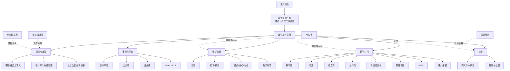

# 授渔信息架构 v1

> 状态：待审阅  
> 日期：2026-11-18  
> 依据：PRD-授渔-v1  
> 本文定义信息归属与工作空间结构，不定义视觉稿。

---

## 1. 架构总原则

> **一个工作任务 = 一个工作空间。**

不是：

> 一个功能 = 一个页面。

教师进入授渔后，不需要理解“专业数据库、知识库、质量检测、材料生成”分别是什么系统；教师只需要完成当前这堂课的准备。

---

## 2. 信息架构图



---

## 3. 教师看到的一条连续路径

```text
我要准备“网线制作”
→ 已带入课程/任务/资料
→ 确认这堂课教什么
→ 准备教学材料
→ 我逐段修改
→ 检查材料是否对得上
→ 整体看一遍
→ 导出
```

教师不需要在路径中“切换模块”。

---

## 4. 工作空间状态

这些状态属于同一个工作空间，不是独立页面。

| 状态 | 教师任务 | 主要内容 | 进入下一步条件 |
|---|---|---|---|
| S1 任务 | 确认要准备哪门课、哪个任务 | 课程、任务、来源 | 任务已带入 |
| S2 依据 | 选择教材或使用通用版 | 教材、通用版提示、来源 | 来源已确认 |
| S3 教学设计 | 确认教什么、怎么组织 | 目标/知识/技能/任务/重难点/过程 | 教师确认 |
| S4 材料 | 查看生成的教学材料 | 五类核心材料 + 扩展材料 | 材料已生成 |
| S5 修改 | 逐段改、删、换例子 | 当前材料、保存状态 | 教师完成修改 |
| S6 检查 | 看跨文件冲突与质量提示 | 问题、位置、依据、建议 | 教师决定处理/忽略 |
| S7 审阅 | 从头到尾看一遍 | 整套材料 | 教师认为可以上课 |
| S8 导出 | 选择合并/分册、Word/PDF | 导出结果、记录 | 文件生成 |

### 状态规则

- 教师可以直接跳到 S4/S5/S7，不必每次走完所有状态；
- 新手默认从上一步到下一步；
- 熟手可直接打开材料或导出；
- 不因跳过而阻断，后续可回来补；
- 不设置“导出前必须审批”的状态门。

---

## 5. 功能归属表

| 功能 | 唯一归属 | 教师何时遇到 | 是否独立入口 |
|---|---|---|---|
| 专业/课程/任务选择 | 备课任务入口 | S1 | 否，工作空间入口 |
| 专业数据库 | 来源支撑 | S1/S2 | 不作为主入口 |
| 教材导入 | 来源 | S2 | 否，工作空间内 |
| 通用资料 | 来源 | S2 | 否 |
| 专业知识库 | 来源/依据 | S2/S3/S4 | 否，按需展开 |
| 知识图谱 | 后台知识关系 | 不主动展示 | 否 |
| AI 辅助 | 工作空间内的动作 | S3/S4/S6 | 否 |
| 教学设计 | 工作空间阶段 | S3 | 否 |
| 教案 | 项目材料 | S4/S5 | 否 |
| 信息页 | 项目材料 | S4/S5 | 否 |
| 工作页 | 项目材料 | S4/S5 | 否 |
| 实训任务书 | 项目材料 | S4/S5 | 否 |
| 思维导图 | 项目扩展材料 | S4/S5 | 否 |
| PPT | 项目扩展材料 | S4/S5 | 否 |
| 课外拓展 | 项目扩展材料 | S4/S5 | 否 |
| 跨文件一致性 | 检查 | S6 | 否，工作空间内 |
| 质量检测 | 检查 | S6 | 否，工作空间内 |
| 整体审阅 | 工作空间状态 | S7 | 否 |
| 导出 | 工作空间状态 | S8 | 否 |
| 成果归档 | 项目结果 | S8 后 | 可以作为独立结果视图 |
| 历史版本 | 项目结果 | 需要时 | 否 |
| 模板库 | 辅助 | 低频 | 可作为二级 |
| 教学应用成效 | 后续 | 低频 | 二级 |
| 资料中心 | 来源管理 | 低频 | 二级 |

---

## 6. 页面/区域关系

### 6.1 核心工作空间

不规定具体栏数和视觉布局；至少承载：

1. 当前课程/任务/来源；
2. 教学设计确认；
3. 教学材料查看与编辑；
4. 质量与一致性提示；
5. 整体审阅；
6. 导出；
7. 保存状态。

### 6.2 辅助信息

以下内容应以“按需出现”的方式存在，不抢占主任务：

- 专业知识库检索结果；
- 来源详情；
- 质量依据；
- 版本记录；
- 教材页码/片段；
- AI 说明。

### 6.3 思维导图/PPT 查看

- 属于项目材料；
- 支持逐步展开；
- 不要求独立课堂投屏；
- 不混入知识图谱。

---

## 7. 不应出现的信息结构

- 一级导航中并列“教案、信息页、工作页、实训任务书、质量检测、知识库”等功能；
- 同一份材料在多个模块重复出现；
- 同一课程上下文需要在多处重新选择；
- 用“功能中心”组织教师工作；
- 为质量检测设置强制跳转页面；
- 用课程工作空间替代当前任务工作空间；
- 把思维导图作为知识图谱的别名。

---

## 8. 架构结论

授渔的信息结构不是“多个教学工具”，而是：

```text
一个当前教学任务
├── 依据
├── 教学设计
├── 材料
├── 检查
└── 导出
```

所有专业数据、知识资料、AI、质量规则都服务于这个当前任务，而不是与它并列。