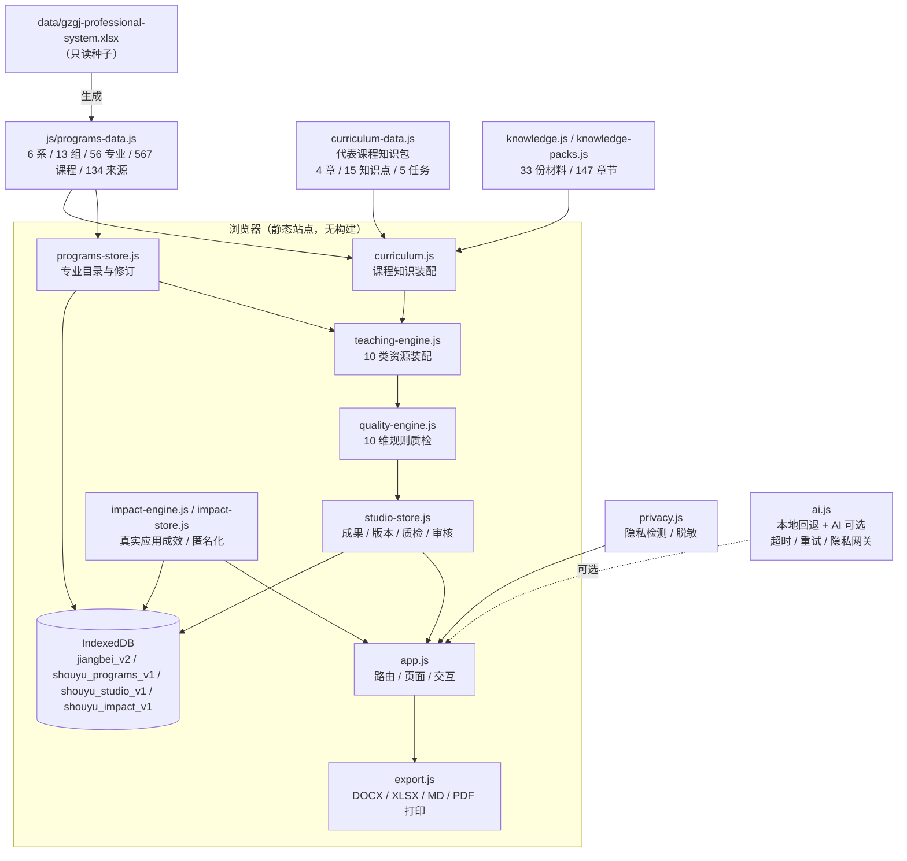

# 授渔 V2.2 · 核心技术架构

## 一、总体架构



## 二、分层说明

1. **种子数据层**：Excel → `programs-data.js`；原始 Excel 随站点保存，生成脚本在 `tools/`。
2. **专业知识层**：`curriculum-data.js` 提供代表性课程包；`curriculum.js` 负责装配、降级与来源。
3. **资源生产层**：`teaching-engine.js` 生成共享上下文的 10 类文档，输出可被现有 `export.js` 消费的 artifact。
4. **质量评价层**：`quality-engine.js` 运行规则，输出维度得分、问题、位置、建议、人工复核标记。
5. **成果管理层**：`studio-store.js` 保存资源包、版本、质检、审核；`impact-store.js` 保存真实应用成效；完整备份包含两者。
6. **交互层**：`app.js` 负责 `/studio`、`/quality`、`/graph`、`/portfolio`、`/demo` 和原页面；`ui-refresh.css` 负责视觉。
7. **安全边界**：所有专业库/成果库默认本机；AI 仅在用户授权后发送必要片段，发送前运行隐私网关；前端无模型 Key。

## 三、关键数据流

### 课程知识包 → 资源包

```text
专业数据库课程
  + 课程知识包（章节/知识点/任务/设备/安全/评价/来源）
  + 教师条件（对象/学时/条件/补充目标）
  → 共享上下文
  → 10 类文档（各自结构不同）
  → 质量报告
  → IndexedDB 成果库
  → 教师审核
  → DOCX/XLSX/Markdown/PDF
```

### 质量检测

```text
资源包 docs
  → 10 条规则（目标/可评价/来源/专业匹配/任务/活动/实训/安全/评价/一致性）
  → 维度分数 + 问题（等级/位置/建议/依据）
  → 加权总分
  → 未审核知识包封顶（待审核 84，参考 72）
  → 人工复核
```

## 四、目录职责

| 目录/文件 | 职责 |
|---|---|
| `data/gzgj-professional-system.xlsx` | 原始只读数据 |
| `tools/generate_programs_data.py` | Excel → 结构化基础目录 |
| `js/programs-data.js` | 生成后的只读基础目录 |
| `js/programs-store.js` | 专业目录修订、CRUD、隐藏/恢复 |
| `js/curriculum-data.js` | 代表课程知识包（带来源/审核状态） |
| `js/curriculum.js` | 课程知识装配与行业参考降级 |
| `js/teaching-engine.js` | 工学一体化 10 类资源生成 |
| `js/quality-engine.js` | 规则质检、一致性、自动结构修复 |
| `js/studio-store.js` | 成果、版本、质检、审核状态持久化 |
| `js/impact-engine.js` | 应用成效校验、聚合、匿名化、CSV |
| `js/impact-store.js` | 应用成效 IndexedDB / 兼容存储 |
| `js/app.js` | 页面与交互编排 |
| `assets/ui-refresh.css` | 设计 Token 与页面样式 |
| `js/export.js` | 标准化 DOCX/XLSX/Markdown/打印 PDF |

## 五、与旧架构的兼容

- 保留原 `engine.js` 五场景、知识库、文件解析、隐私、对话、编辑器、导出和备份；
- 新能力使用独立模块，不修改旧生成函数的结构；
- 新资源包仍使用旧 `artifact` 结构，因此可复用旧编辑器和导出；
- 新增 IndexedDB 数据库，不迁移、不破坏原有 `jiangbei_v2` 数据；
- GitHub Pages 静态部署保持不变。