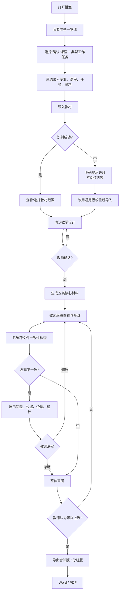

# 授渔用户流程 v1

> 状态：待审阅  
> 日期：2026-11-18  
> 依据：PRD-授渔-v1、信息架构-授渔-v1

---

## 1. 主流程（有教材）



---

## 2. 主流程（无教材，使用通用版）

```text
打开授渔
→ 选择课程 + 任务
→ 未导入教材
→ 进入通用版流程
→ 明确标注“通用资料，不是本校教材，需要核对”
→ 确认教学设计
→ 生成材料
→ 教师核对/修改
→ 检查
→ 审阅
→ 导出
```

**关键规则**

- 教师没有被阻断；
- 通用内容不冒充校本教材；
- 教师可以之后导入教材替换；
- 来源始终可追溯。

---

## 3. 扩展材料流程

```text
五类核心材料已生成
→ 生成思维导图（可逐步展开）
→ 生成 PPT（可逐步展开）
→ 生成课外拓展（独立学生任务）
→ 教师选择是否纳入导出
```

**边界**

- 思维导图不是知识图谱；
- 不做课堂投屏；
- 课外拓展不污染核心五类材料；
- 逐步展开由教师控制，不自动逐页播放。

---

## 4. 教师修改流程

```text
打开某份材料
→ 选择一段
→ 修改 / 换例子 / 删除 / 新增
→ 保存
→ 只更新当前材料
→ 其他材料保持原样
→ 显示保存状态
```

**规则**

- 不自动同步；
- 不覆盖其他材料；
- 修改可恢复；
- 保存失败要提示，不能显示“已保存”。

---

## 5. 跨文件检查流程

```text
运行检查
→ 系统比对任务、步骤、学时、目标、评价等
→ 展示冲突：材料 A ↔ 材料 B
→ 教师查看位置与依据
→ 教师选择：修改 / 忽略 / 稍后处理
→ 重新检查可再次提示
```

**规则**

- 系统不自动修正；
- 教师可以忽略；
- 忽略不改变内容；
- 导出前不强制处理。

---

## 6. 整体审阅流程

```text
进入整体审阅
→ 按顺序看：教学设计 → 教案 → 信息页 → 工作页 → 实训任务书
→ 查看未处理的一致性问题
→ 返回任意材料修改
→ 回到审阅位置
→ 教师判断“可以上课了”
```

**规则**

- 系统不替教师判断“可以上课”；
- 不强制重新逐段确认；
- 不设审批门。

---

## 7. 导出流程

```text
点击导出
→ 选择合并版 / 分册版 / 两者
→ 选择 Word / PDF / 两者
→ 生成文件
→ 显示成功或失败
→ 成功写入导出记录
```

**规则**

- 教师自己决定；
- 导出失败不得记录成功；
- 合并版和分册版内容同源；
- 分册版五份均能独立打开；
- 导出前只提示质量/冲突，不阻断。

---

## 8. 评委独立审核流程

```text
评委打开网站
→ 看到“我要准备一堂课”
→ 自行选择课程和任务
→ 看到上下文自动带入
→ 导入教材或使用通用版
→ 看到教学设计
→ 生成材料
→ 自己修改一段
→ 检查跨文件不一致
→ 整体审阅
→ 导出
→ 查看导图/PPT 逐步展开
→ 查看课外拓展
```

**产品必须保证**

- 无需作者在旁边解释；
- 每一步有清楚的下一步；
- 页面不要求评委先学习“功能地图”；
- 评委能看到“一堂课被完整准备出来”。

---

## 9. 异常与恢复

| 情况 | 处理 |
|---|---|
| 教材识别失败 | 明确说明，不伪造；允许通用版或重试 |
| AI 不可用 | 明确提示；核心流程不中断；不假装生成 |
| 保存失败 | 明确提示；不得显示“已保存” |
| 导出失败 | 明确提示；不写成功记录 |
| 刷新/关闭 | 恢复当前项目与修改 |
| 跨文件冲突 | 提示位置和依据；教师决定 |
| 来源缺失 | 标注“来源不足”；不能伪装成校本 |
| 教师忽略问题 | 保留可查记录；不阻断导出 |

---

## 10. 角色与决定权

| 决定 | 谁决定 |
|---|---|
| 准备哪门课/哪个任务 | 教师 |
| 用教材还是通用版 | 教师 |
| 教学目标、重点、难点 | 教师确认 |
| 是否采用 AI 建议 | 教师 |
| 哪一段修改/删除 | 教师 |
| 跨文件冲突怎么处理 | 教师 |
| 是否可以上课 | 教师 |
| 是否导出 | 教师 |
| 是否布置课外拓展 | 教师 |
| 系统做什么 | 提供整理、生成、检查、提示 |

---

## 11. 流程结论

教师始终只做一件事：

> **把“网线制作”这堂课准备好。**

系统负责把专业数据、知识来源、AI 生成、五类材料、质量检查和导出组织在这件事背后。